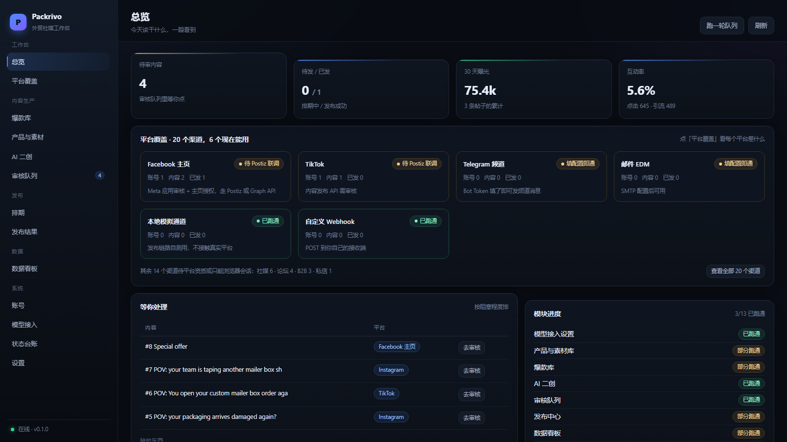
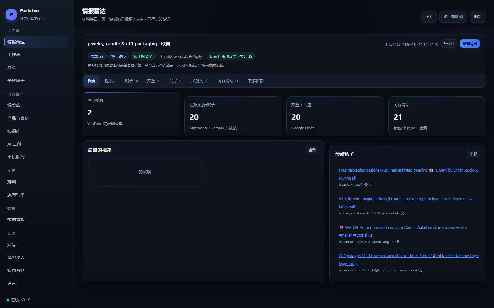
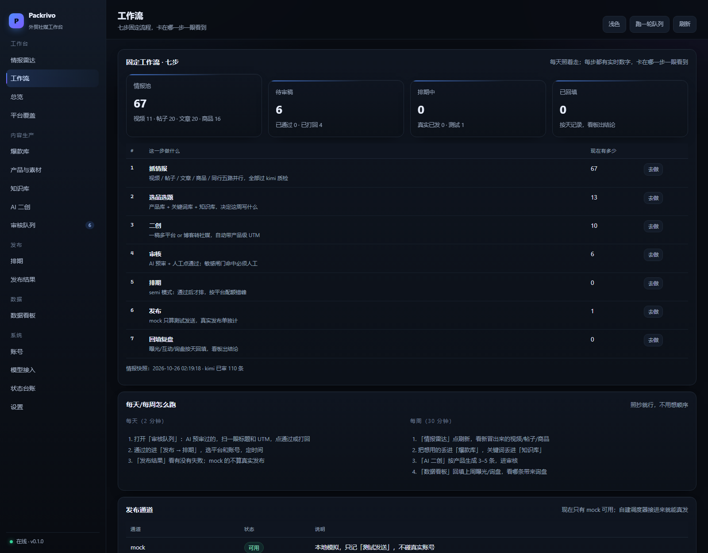
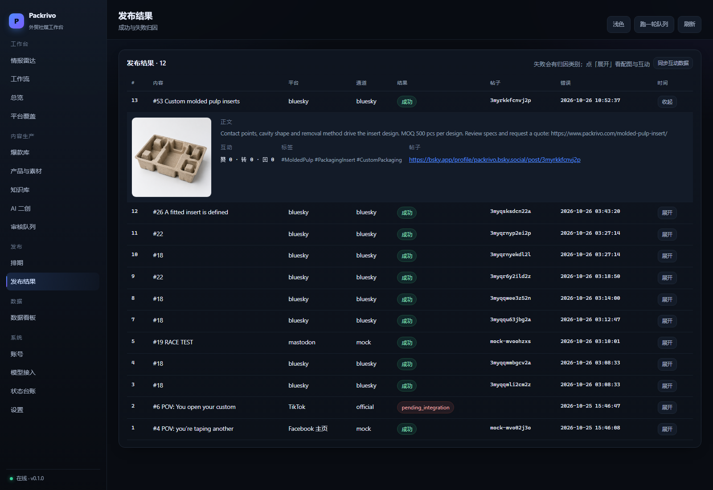
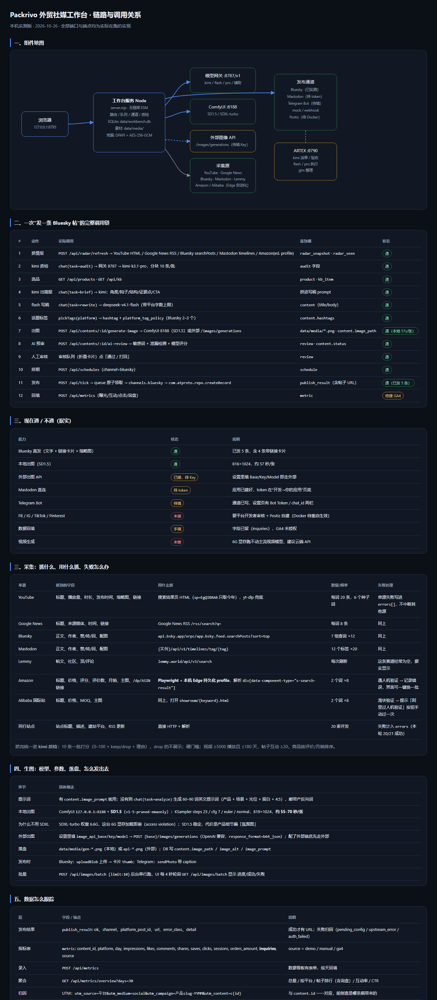
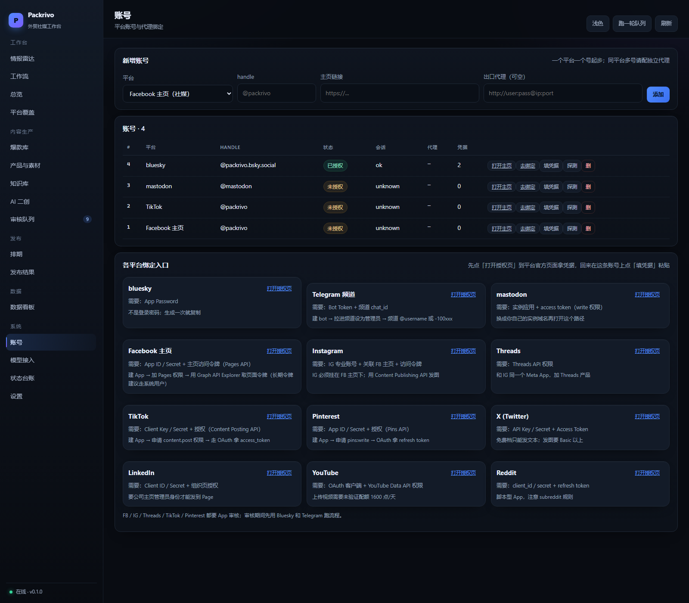
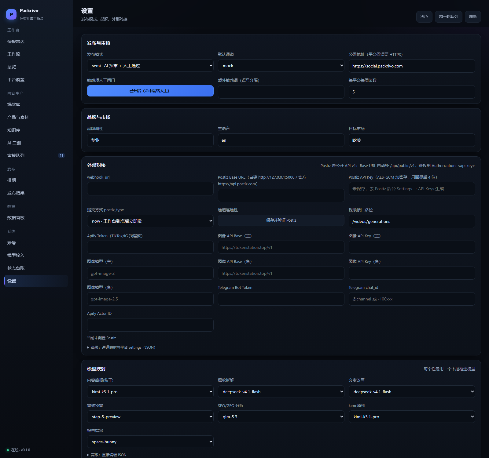
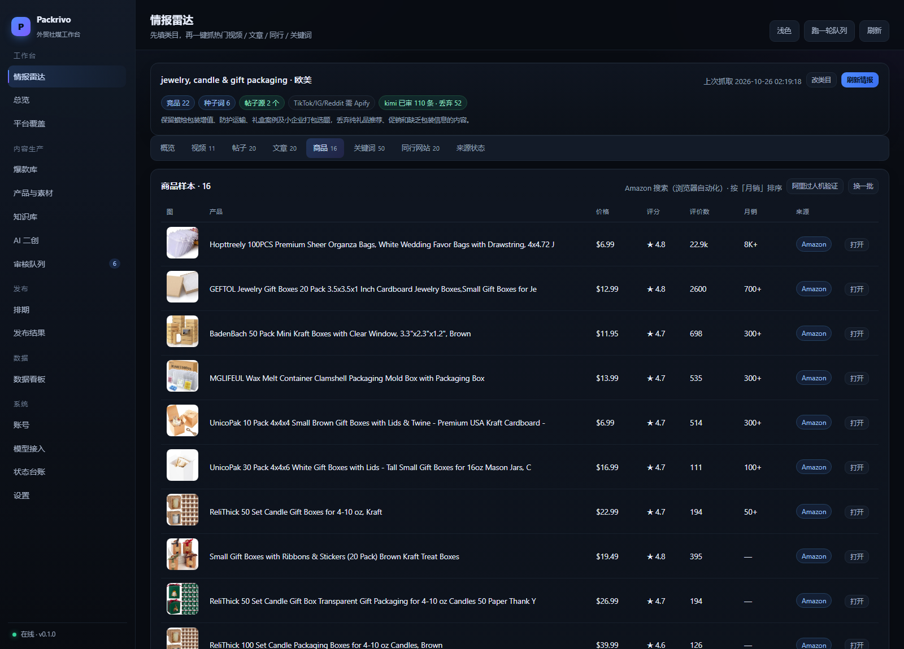

# Packrivo 社媒自动发布工作台

**Social Media Auto-Publish Workbench** · 本地单机版 v0.1

> ## 🚧 状态：半成品（Work in Progress）
>
> 主链路已在本机跑通、有实测记录；**官方平台发布（Meta / TikTok / Pinterest / YouTube）与素材上传尚未接通**——缺的是账号资质、App 审核、一台跑起来的 Postiz 和几个外部 Key，不是代码骨架。
>
> 缺口逐条写在 **[docs/STATUS.md](docs/STATUS.md)**：哪块 ✅ 真跑过、哪块卡在什么外部依赖上。
> 开发过程与当时的实测数字留在 **[docs/10-v0.1-开发记录.md](docs/10-v0.1-开发记录.md)**。

单机可跑的外贸社媒内容工作台，把「看同行在火什么」到「内容发出去、数据回收」串成一条流水线：

```
情报雷达 → 爆款入库 → 结构拆解 → AI 一稿多平台 → AI 预审 + 敏感项人工闸门 → 排期 → 发布回执 → 指标回收
```

零重型框架：Node 24 内置 `node:sqlite` 存库，单页前端无构建步骤，双击 `启动.bat` 起服务，浏览器开 `http://127.0.0.1:8795`。

## 这是什么 / 不是什么

| 是 | 不是 |
|---|---|
| 个人自用的本地社媒自动发布工作台，代码 + 需求基线 + 决策记录一起存档 | 开箱即用的 SaaS |
| 主链路每个环节都有实测记录（接口返回、自测脚本、真实渲染截图） | 完整商业产品：没有多用户、计费、权限体系 |
| 发布适配器按 Postiz 公开 API v1 的 OpenAPI 契约实现，本机契约桩跑过 21 项断言 | 已经接上 Meta / TikTok 官方 API 的成品 |
| 凭据落库前 DPAPI 包主密钥 + AES-256-GCM 列级加密 | 可以多机共享同一份 `data/` 的东西 |

## 界面

| 总览 | 情报雷达 |
|---|---|
|  |  |

| 固定工作流 | 审核队列（AI 分析 + 人工闸门） |
|---|---|
|  |  |

| 全链路视图 | 账号绑定 |
|---|---|
|  |  |

| 设置 | 产品素材 |
|---|---|
|  |  |

## 快速开始

```powershell
# 需要 Node 24+（用到内置 node:sqlite 与 zstd）
cd social-workbench
node app\server.mjs
# 或双击 启动.bat
```

打开 **http://127.0.0.1:8795**。端口冲突时：`$env:SWB_PORT=8796; node app\server.mjs`。

可选依赖（`npm i`）：

| 包 | 用途 | 不装会怎样 |
|---|---|---|
| `playwright-core` | 浏览器通道（登录态抓取、页面自动化） | 浏览器类通道不可用，其它照跑 |
| `sharp` | 缩略图裁剪/压缩 | 缩略图走原图，慢一点 |

`tools\yt-dlp.exe`（17MB，Unlicense）用于 YouTube 精确播放量/时长采集，**未随仓库分发**，需要时自行放到 `tools\` 下。

## 目录

```
app\
  server.mjs    HTTP 接口 + 静态页 + 调度循环（前后端一起的主入口）
  db.mjs        SQLite 表结构：账号/产品/爆款/内容/审核/排期/结果/任务/审计
  crypto.mjs    DPAPI 包主密钥 + AES-256-GCM 列级加密
  llm.mjs       模型网关客户端（任务→模型映射，按优先级主备降级）
  channels.mjs  发布适配器（mock / webhook / postiz / 官方 API 占位）
  postiz.mjs    Postiz 公开 API v1 适配器（契约对齐）
  queue.mjs     排期调度 + 令牌桶限速 + 退避重试 + 熔断冷却
  radar.mjs     情报雷达：YouTube / Mastodon / Lemmy / Bluesky / News / 同行站点
  sources.mjs   数据源抓取与行业词过滤
  quality.mjs   内容质量规则（敏感项闸门、相似度、标签规范）
  browser.mjs   浏览器通道（CDP / Playwright）
  comfy.mjs     本地生图服务对接
web\            单页界面（index.html + app.js + style.css，无构建）
service\        启动/停止/看门狗脚本 + 本地生图小服务
ops\            开发期的一次性脚本与自测（含 Postiz 契约桩、21 项断言）
docs\           需求基线、决策记录、平台调研、缺口台账、截图
data\           运行数据（数据库 / 主密钥 / 浏览器 profile）—— 不进仓库
```

## 数据与密钥

`data\` 整个目录不进仓库，原因写在 `.gitignore` 里：

| 文件 | 是什么 | 为什么不能上传 |
|---|---|---|
| `workbench.db` | SQLite 主库（含账号、内容、排期、审计） | 有真实业务数据 |
| `master.key.dpapi` | DPAPI 包裹的主密钥 | 解开就能读所有加密列 |
| `browser-profile\`、`edge-cdp\` | 登录态浏览器 profile | 含 cookie / token |
| `media\`、`thumbs\` | 素材与缩略图 | 体积大，且含客户素材 |

首次启动会自动建库、生成主密钥。换机器要把凭据重新录一遍——DPAPI 绑当前 Windows 用户。

## 模型接入

默认走本机 OpenAI 兼容网关（`http://127.0.0.1:8787/v1`），任务→模型在「设置 → `llm_task_models`」里配：

```json
{"deconstruct":"deepseek-v4.1-flash","rewrite":"deepseek-v4.1-flash","review":"step-5-preview","report":"space-bunny"}
```

自定义接口在「模型接入」页加，按优先级升序组成主备链，主接口失败自动降级。思考型模型要把 `max_tokens` 给到 1600–2600，否则推理过程吃光配额、正文为空；答案常落在 `reasoning_content`，代码已做兜底取用。

## 文档

| 文件 | 内容 |
|---|---|
| [docs/STATUS.md](docs/STATUS.md) | **缺口台账**：能跑的 / 卡住的 / 已知的坑 / 下一步优先级 |
| [docs/10-v0.1-开发记录.md](docs/10-v0.1-开发记录.md) | v0.1 开发过程原始记录与实测数字 |
| [docs/00-产品定义与模块清单.md](docs/00-产品定义与模块清单.md) | 产品边界与模块拆解 |
| [docs/01-需求基线.md](docs/01-需求基线.md) | 需求原文逐条锁定 |
| [docs/02-待确认问题.md](docs/02-待确认问题.md) | 未决问题与默认取值 |
| [docs/03-落地决策记录.md](docs/03-落地决策记录.md) | 域名、关键词、审核闸门、视频等决策 |
| [docs/04-关键词找爆款.md](docs/04-关键词找爆款.md) | 关键词口径、打分方式、已排除的路子 |
| [docs/05-开源项目复用清单.md](docs/05-开源项目复用清单.md) | 可复用项目、许可证风险 |
| [docs/06-类目情报.md](docs/06-类目情报.md) | 20 个同行域名逐个核验 |
| [docs/08-内容质量复核-20261026.md](docs/08-内容质量复核-20261026.md) | 内容质量逐条复核 |
| [docs/competitors.md](docs/competitors.md) | 竞品功能与差异化空档 |
| [docs/research/](docs/research/) | 十个平台的接口 / 限流 / 风控调研 |

## 说明

- 仓库是个人工作台的快照，接口契约与页面细节随实现变动，不保证向后兼容。
- 未附开源许可证时默认保留所有权利；要复用请先开 Issue 说明用途。
- 涉及第三方平台的部分只实现其**公开文档化接口**；没有公开搜索接口的平台（Pinterest / Pixelfed / Tumblr）已明确排除，不硬凑。
